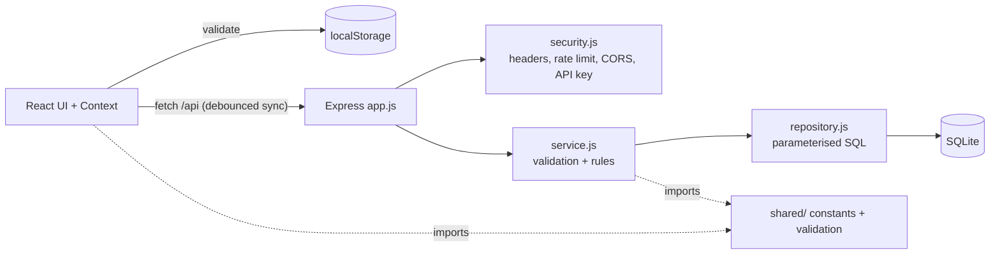

# Architecture

## Design decisions
- **Separation of concerns**: UI components only render; maths is in `src/lib/health.js`; HTTP is in `app.js`; rules in
  `service.js`; SQL only in `repository.js`. Each layer is tested on its own.
- **Single source of truth**: limits and validation live in `shared/` so the browser, the API and the DB `CHECK`
  constraints can never disagree.
- **Local-first**: the UI never blocks on the network. State is saved to `localStorage` first; the API mirrors it when
  reachable (status shown in the footer). On first contact the server is seeded from the browser, afterwards the server
  is the source of truth for a new device.
- **`node:sqlite`**: zero native build step; the repository interface would let another database replace it.
- **Scalability notes**: logs are keyed by date (indexed primary key), range queries are capped at 400 days, bodies at
  100 kb. A multi-user version would add a `user_id` column and real authentication (out of scope: single-user spec).

## Data model
`profile(id=1, height_cm, weight_kg, age, sex, unit, goal, activity, updated_at)`
`logs(date PK, water_ml, sleep_hours, rating, weight_kg NULL, bed, wake, updated_at)`

## API
Base path `/api`. JSON in/out. Errors: `{ "error": string, "details"?: { field: message } }`.

| Method | Path | Purpose | Notes |
| --- | --- | --- | --- |
| GET | `/health` | Liveness | Public even when `API_KEY` is set |
| GET | `/profile` | Read profile | 404 if none |
| PUT | `/profile` | Create/replace profile | 400 with per-field `details` |
| GET | `/logs?from&to` | Logs by inclusive date range | Default last 90 days, max 400 days |
| PUT | `/logs/:date` | Merge fields into one day | Date must be real, not in the future |
| PUT | `/state` | Bulk upsert `{profile?, logs?}` | Validated first, written atomically |
| DELETE | `/state` | Delete all data | 204 |

Status codes: 200, 204, 400 (validation), 401 (bad key), 404, 413 (body too large), 429 (rate limit), 500.
